  <picture>
    <source media="(prefers-color-scheme: dark)" srcset="./assets/dark_mode-1792356993.svg" />
    <source media="(prefers-color-scheme: light)" srcset="./assets/light_mode-1792356993.svg" />
    
  </picture>

  <a href="https://github.com/Tharusha-Gunarathne"><picture><source media="(prefers-color-scheme: dark)" srcset="./assets/btn_github_dark.svg" /></picture></a>
  &nbsp;
  <a href="https://www.linkedin.com/in/tharusha-gunarathne/"><picture><source media="(prefers-color-scheme: dark)" srcset="./assets/btn_linkedin_dark.svg" /></picture></a>
  &nbsp;
  <a href="mailto:tharusha1205@gmail.com"><picture><source media="(prefers-color-scheme: dark)" srcset="./assets/btn_email_dark.svg" /></picture></a>

